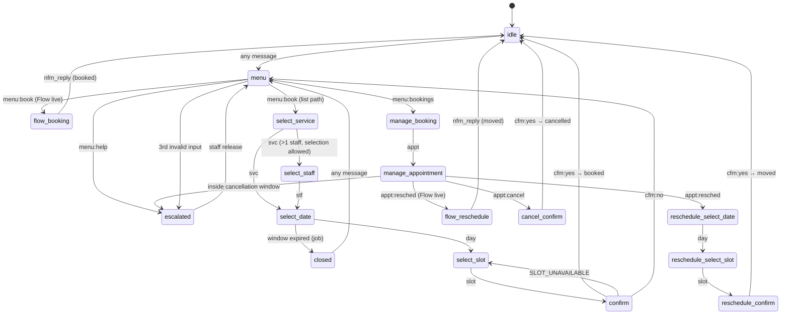

# WhatsApp channel (WS-C)

This workstream is the customer-facing channel. It covers the Meta Graph client, the signed webhook, the deterministic conversation engine, WhatsApp Flows, onboarding (`/v1/whatsapp`), the staff inbox, notifications (confirmations, reminders, Expo push) and the WhatsApp cron jobs. The contract is `docs/BUILD_PLAN.md` §4–§5. The deviations are listed at the end.

```
backend/src/whatsapp/
  graph.ts            Graph API client: retry/backoff, typed Meta error kinds
  messages.ts         message builders (WhatsApp limits) → Cloud API payloads
  ids.ts              reply-id grammar (parse/format)
  format.ts           dates, times, money in the business timezone (ICU-independent)
  signature.ts        X-Hub-Signature-256 (HMAC-SHA256 over the raw body)
  repo.ts             persistence port (types derived from shared/database.types.ts)
  supabaseRepo.ts     Supabase implementation of the port
  deps.ts             dependency bundle (repo, Graph factory, push, clock, ids)
  outbound.ts         the one send path: store → send → stamp; escalate()
  engine/             types, copy, render, transition (pure), run, executor, index (pipeline)
  webhook/            events.ts (zod → typed events + dedupe keys), process.ts
  flows/              crypto.ts, token.ts, handler.ts (data_exchange)
  onboarding.ts       connect / Embedded Signup / sync / pause / resume / disconnect / test
  inbox.ts            staff reply, release, resolve escalation
  jobs.ts             reminders, conversation-expiry, waba-health, token-refresh
  assets.ts           bundled Flow JSON + templates (JSON imports)
backend/src/notifications/   NotificationService (index.ts), customer copy, Expo push
backend/src/routes/whatsapp/ webhook.ts, flows.ts, v1.ts (/v1/whatsapp), inbox.ts (/v1), schemas.ts
backend/whatsapp/            flows/booking.json, flows/reschedule.json, templates.json, generate-flow-keys.mjs
backend/test/whatsapp/       fakes + table-driven and end-to-end tests
```

No new dependencies were added. The code only uses Web-standard APIs, `node:crypto` / `node:buffer`, hono, zod and luxon, so it runs unchanged on Node (Vitest) and on Supabase Edge Functions (Deno). Bundled JSON is loaded with `import … with { type: 'json' }`.

## Setup

### Environment

| Variable | Used for |
| --- | --- |
| `META_APP_ID`, `META_APP_SECRET` | webhook signatures, token checks (`debug_token`), Embedded Signup code exchange, token refresh |
| `META_GRAPH_VERSION` | Graph version (default `v23.0`) |
| `WHATSAPP_VERIFY_TOKEN` | webhook subscription handshake |
| `WHATSAPP_FLOW_PRIVATE_KEY` (+ `_PASSPHRASE`) | Flows endpoint decryption; the public half is uploaded on connect/sync |
| `FLOW_TOKEN_SECRET` | signs flow tokens |
| `WHATSAPP_REGISTRATION_PIN` | two-step PIN, used only when a number is not registered yet |
| `TOKEN_ENCRYPTION_KEY` | AES-256-GCM for stored access tokens |
| `API_BASE_URL` | public API base, e.g. `https://<ref>.supabase.co/functions/v1/api`. The Flows `endpoint_uri` is `${API_BASE_URL}/flows/whatsapp` |
| `EXPO_ACCESS_TOKEN` | optional, Expo push |

Without `WHATSAPP_FLOW_PRIVATE_KEY`, `FLOW_TOKEN_SECRET` or `API_BASE_URL`, Flows are skipped and the bot uses the list path. Everything else still works.

### 1. Meta app and webhook

1. Create a Meta app of type *Business* and add the *WhatsApp* product.
2. Under *WhatsApp → Configuration → Webhook*, set the callback URL to `${API_BASE_URL}/webhooks/whatsapp` and the verify token to `WHATSAPP_VERIFY_TOKEN`. Meta calls `GET` with `hub.mode=subscribe`, and the API echoes `hub.challenge`.
3. Subscribe the webhook fields `messages`, `message_template_status_update`, `phone_number_quality_update` and `account_update`.
4. Copy the app secret into `META_APP_SECRET`. Every `POST` is checked against `X-Hub-Signature-256` before it is parsed.

### 2. Flows keys

```bash
node backend/whatsapp/generate-flow-keys.mjs [passphrase]
```

This prints `WHATSAPP_FLOW_PRIVATE_KEY` as one line with `\n` escapes (the backend accepts escaped or real newlines), plus the public key. You don't need to upload the public key by hand: `connect` and `sync` call `POST /{phone-number-id}/whatsapp_business_encryption` with it. Set `FLOW_TOKEN_SECRET` to a random string.

### 3a. Connect with a system-user token (recommended first path)

1. In *Business settings → Users → System users*, create an admin system user. Assign it the app and the WhatsApp account (full control), then generate a token with `whatsapp_business_messaging` and `whatsapp_business_management`. System-user tokens don't expire.
2. Find the WABA id and the phone number id under *WhatsApp → API setup*.
3. As the owner, call:

```http
POST /v1/whatsapp/connect
Idempotency-Key: <uuid>
{ "waba_id": "…", "phone_number_id": "…", "access_token": "EAAG…" }
```

The token is checked with `debug_token` when the app credentials are set, stored encrypted (`encryptSecret`), and never returned. Setup then runs (see below). The response is the `WhatsAppChannelDTO`.

### 3b. Embedded Signup

The app runs Meta's Embedded Signup (Facebook Login for Business with the WhatsApp configuration), then posts the result:

```http
POST /v1/whatsapp/embedded-signup
{ "code": "…", "waba_id": "…", "phone_number_id": "…" }
```

The API exchanges the code (`/oauth/access_token`), reads the token expiry with `debug_token`, then runs the same connect and setup as 3a.

### Setup steps (connect and `sync`)

Every step is idempotent, so `POST /v1/whatsapp/sync` resumes after a failure.

| Step | Graph call | Required |
| --- | --- | --- |
| `subscribe` | `POST /{waba}/subscribed_apps` | yes |
| `phone` | `GET /{phone-number-id}` (display number, name, quality, limit, status) | yes |
| `register` | `POST /{phone-number-id}/register` with the PIN, only when the status is not `CONNECTED` | yes |
| `flow_key` | `POST /{phone-number-id}/whatsapp_business_encryption` | no |
| `flows` | `GET /{waba}/flows`, then create-and-publish `booking_v1` / `reschedule_v1` with `endpoint_uri`. A draft is updated and published, and a published one is reused | no |
| `templates` | `GET /{waba}/message_templates`, then create the four utility templates that are missing and upsert `message_templates` | no |

- **Required steps:** a failure stores `last_error = "<step>: <kind> (<code>): <message>"`, sets `needs_reauth` for error 190, and answers `502 UPSTREAM_META_ERROR` with `details.step`.
- **Optional steps:** a failure is recorded in `last_error` and the number still goes `live`, because the list path and session messages don't need Flows or templates.
- A paused number stays paused through a sync.

The other endpoints (all owner-only, except `GET` which any member can call):

- `GET /v1/whatsapp` returns the channel status.
- `pause` stops the bot. Inbound messages are stored and flagged, and staff can still reply.
- `resume` is allowed from `paused`.
- `disconnect` unsubscribes the app (best effort) and deletes the token.
- `test-message {to}` sends Meta's `hello_world` template to a normalised number.

### Templates

`backend/whatsapp/templates.json` holds four `UTILITY` templates in `en`. Each has body parameters `{{1}}` business, `{{2}}` service, `{{3}}` "Tue 30 Sep 2026 at 09:00" and `{{4}}` staff.

| Template | Quick replies (payloads) |
| --- | --- |
| `booking_confirmation` | Manage booking → `appt:<id>` |
| `booking_reminder` | Keep → `appt:keep:<id>`, Reschedule → `appt:resched:<id>`, Cancel → `appt:cancel:<id>` |
| `booking_rescheduled` | Manage booking → `appt:<id>` |
| `booking_cancelled` | Book again → `menu:book` |

Quick-reply payloads go through the same ID grammar as buttons, so a reminder tap works from any conversation state. Template status webhooks and the hourly health job keep `message_templates.status` current.

## Conversation engine

`transition(snapshot, input, ctx)` in `engine/transition.ts` is pure: it does no I/O and reads no clock or randomness. `ctx` carries the injected `now`, a pre-generated attempt id and pre-fetched data. When it needs data (services, staff, days, slots, upcoming appointments, one appointment), it returns `{ need }`, and `engine/run.ts` fetches that through `BookingService` and calls it again. Availability is therefore always live, while the table tests feed it plain data.



The diagram shows the main paths only. These rules apply everywhere:

- `nav:back` steps back one screen and `nav:menu` shows the menu from any state.
- `menu:*` and `appt:*` ids (including template quick replies) work from any state except `escalated`.
- Leaving an active attempt without finishing it marks the attempt `abandoned`.

**Rules**

- **Free text is never read.** A text message is just `{kind:'text'}`. In `idle`/`closed` any message shows the menu (**Book**, **My bookings**, **Talk to us**). In any other state, input that doesn't fit the state costs a strike and re-sends the current step with the fixed prefix "Sorry, I can only respond to the options below…". The 3rd strike escalates (`unrecognised_input`). A valid input resets the count.
- **`escalated`:** the bot sends one fixed acknowledgement (`context.ackSent`) and then nothing, until staff release the thread.
- **Blocked clients** get one fixed notice per 24h and nothing else.
- **Paging:** lists show 9 data rows, then a "More" row (`days:more:<page>` and so on), then navigation rows up to WhatsApp's 10-row limit. A `more` id for another list, or a page that doesn't exist, counts as invalid input.
- **Stale selections:** a slot that is no longer offered for the same date re-renders the fresh slots with "Sorry, that slot was just taken" (no strike). The same happens when `BookingService` returns `SLOT_UNAVAILABLE` at confirm, and the attempt stays open.
- **Cancellation window:** cancelling or rescheduling a booking less than `cancellation_window_minutes` before the start escalates (`cancellation_window`) with a fixed message. `BookingService` enforces the same rule, and its `RULE_VIOLATION CANCELLATION_WINDOW` maps to the same escalation.
- **Double taps:** while a booking mutation is in flight (`context.busySince`, 60 s), any input gets a fixed "one moment" reply.

### Reply-id grammar

Ids are parsed by prefix and validated strictly (UUIDs, real calendar dates, ISO instants, pages 0–999, at most 200 characters). Anything else is `null`, which the engine treats as invalid input.

```
menu:book | menu:bookings | menu:help
svc:<uuid>                      svcs:more:<page>
stf:<uuid|any>                  stfs:more:<page>
day:<YYYY-MM-DD>                days:more:<page>
slot:<iso>|<uuid|any>           slots:more:<page>
cfm:yes | cfm:no
appt:<uuid> | appt:resched:<uuid> | appt:cancel:<uuid> | appt:keep:<uuid>
                                appts:more:<page>
nav:back | nav:menu
```

### Pipeline, persistence and idempotency

For each inbound message (`engine/index.ts`):

1. `upsert_client_by_phone`. The WhatsApp profile name only fills a blank name.
2. Get or create the conversation.
3. Insert the inbound `messages` row. The unique `wa_message_id` makes a redelivery a no-op.
4. Update the 24h window fields.
5. Mark the message read.
6. Run the transition and save with compare-and-set on `conversations.version`. On a conflict, reload and re-run, up to 3 tries.
7. Execute the actions. A booking mutation is always the last action, and its result is fed back as an internal `booking_result` input for a second transition.

- **Idempotency keys** for `BookingService`:
  - `wa:<wamid>` for list-path creates.
  - `wa-flow:<flow token>:<slot id>` for Flow bookings.
  - Reschedule and cancel are idempotent by state.
- **Outbound messages** are all stored in `messages` (`queued` → `sent` with the wamid, or `failed` with `{kind, code}`).
  - Booking confirmations carry a dedupe key (`confirm:<id>:created`, `confirm:<id>:rescheduled:<starts_at>`, `confirm:<id>:cancelled`). The engine, the Flow completion and `NotificationService` therefore never confirm the same change twice.
  - A confirmation that goes out also writes a `confirmation_sent` appointment event.
- **`booking_attempts`** (channel `whatsapp`, `session_key = wa:<attempt id>`):
  - Starting a booking inserts the row.
  - Every transition while it is active appends `{step: <state>, at}`. Flow screens append `flow:<SCREEN>`.
  - It finishes as `completed` (with `appointment_id`), `failed` (with `error_code`) or `abandoned`.

### 24-hour policy

- `window_expires_at = last_inbound_at + 24h`. `last_inbound_at` never moves backwards, and a message timestamp from the future is capped at `now`.
- Engine replies are always inside the window, because they answer an inbound message.
- `NotificationService` sends a session message (interactive, with a Manage/Book button) inside the window and the matching template outside it.
- Reminders always use the `booking_reminder` template, because only templates carry quick replies.
- A staff reply outside the window is refused with `409 WINDOW_CLOSED`. Meta's error 131047 maps to the same code.
- The `conversation-expiry` job closes threads that are mid-flow when their window passes and abandons their attempts. Escalated threads are left for staff.

## WhatsApp Flows

- **Transport:** `POST /flows/whatsapp`.
  - The request has an RSA-OAEP-SHA256 wrapped AES-128 key and an AES-GCM body.
  - The response is AES-GCM with the bit-inverted IV, sent as base64 text.
  - `421` means the body can't be decrypted or the key is missing, so Meta re-fetches the public key.
  - `427` means the flow token is invalid or expired, or the conversation or appointment is gone.
  - `432` means an `X-Hub-Signature-256` header is present but wrong.
- **Actions:**
  - `ping` → `{data:{status:'active'}}`.
  - Client error notifications (`data.error`) → `{data:{acknowledged:true}}`, plus a `flow_error` escalation.
  - `INIT` / `BACK` → first screen.
  - `data_exchange` → the next screen.
- **Flow token:** `v1.<conversationId>.<subject>.<expiry>.<hmac>`.
  - `subject` is the booking attempt id, or `rs-<appointmentId>` for a reschedule Flow.
  - `expiry` is unix seconds (24h).
  - `hmac` is HMAC-SHA256 with `FLOW_TOKEN_SECRET` over the first four parts.
- **Booking screens:** SERVICE → STAFF (skipped with one qualified staff member or when selection is off) → DATE → SLOT → DETAILS (name, optional email) → SUMMARY → SUCCESS.
  - Each step re-reads live availability.
  - The booking is created on SUMMARY, where `BookingService` re-validates and replays by key, so a retried SUMMARY returns the same appointment.
  - Errors keep the customer on the submitted screen with `error_message`.
- **Reschedule screens:** DATE → SLOT → SUMMARY → SUCCESS, with the same staff member.
- **Flow JSON:** `backend/whatsapp/flows/*.json` (Flow JSON `7.1`, `data_api_version` `3.0`, `routing_model` declared, SUMMARY terminal).
- **SUCCESS:** the response carries `extension_message_response.params = {flow_token, appointment_id, flow}`. Meta then sends an `nfm_reply` to the webhook. The engine verifies the token and the conversation, loads the appointment, closes the attempt and sends the in-chat confirmation. The dedupe key keeps that confirmation to one per change.

## Webhook

- **Signature check:** `POST /webhooks/whatsapp` checks the signature on the raw body. A bad or missing signature gets `401` with the error envelope, and nothing is stored.
- **Parsing:** zod parses the payload into typed events.
- **Event keys:** each event is recorded in `webhook_events` (`source='whatsapp'`) with a stable key:
  - `msg:<wamid>`
  - `status:<wamid>:<status>`
  - `tpl:<template id>:<event>:<entry time>`
  - `quality:<waba>:<event>:<time>`
  - `account:<waba>:<event>:<time>`
  - `other:<field>:<hash>`
- **Stored payload:** minimal and PII-free (ids, types and timestamps only).
- **Recording, dedupe and retry:**
  - A duplicate that was already processed is skipped.
  - An event that was recorded but never finished is retried, up to 5 attempts.
  - After handling, `processed_at` is stamped, and `error` holds a short outcome note or `null`.
  - A failing event never blocks the others.
- **Response code:** authentic payloads get `200`. The one exception is when the events cannot be recorded at all (database down), which gets `500` so that Meta redelivers.
- **Message events:**
  - A message to an **unlinked number** is recorded (`error='unlinked_number'`) with no reply and no client created.
  - A message to a **paused / disconnected / needs_reauth / pending** number is stored and flagged with an `unlinked_number` escalation (note `channel_<status>`), without a bot reply.
- **Status events:**
  - Statuses only move forward (`sent → delivered → read`, and `failed` always wins), and set `delivered_at` / `read_at` / `error`.
  - A failed message marked `critical` (a booking confirmation or change) opens a `delivery_failed` escalation.
- **Account-level events:**
  - `message_template_status_update` updates `message_templates` by Meta id, or by name and language.
  - `phone_number_quality_update` updates quality and limit.
  - `account_update` records the event in `last_error`, and `PARTNER_REMOVED` / `ACCOUNT_DELETED` disconnect the number.

## Graph client

- **Retries:** HTTP 429, 5xx, network errors and the throttling codes (4, 80007, 130429, 131056) are retried with exponential backoff and jitter. The default is 3 retries at 300 ms × 2^n. `fetch`, `sleep` and `random` are injectable.
- **Error kinds:**

| Meta code | Kind | Effect |
| --- | --- | --- |
| 190 | `token_invalid` | account → `needs_reauth` |
| 131047 | `outside_window` | staff reply → `WINDOW_CLOSED` |
| 131026, 131051 | `undeliverable` | no retry; escalated if critical |
| 131009, 100 | `bad_params` | no retry |
| other | `other` | no retry |

- **Summaries:** `GraphError.summary()` is the only error text that is stored or logged. It never includes tokens or bodies.

## Notifications and push

- **`NotificationService.appointmentChanged`:**
  - Loads the appointment scoped by business.
  - When the actor is a customer, it pushes the business's devices ("New booking", "Booking moved" or "Booking cancelled", plus service and time, never who).
  - When `notifyCustomer` is set, it sends the customer message: a session message or a template, `critical`, deduped, with `confirmation_sent` recorded.
  - It never throws.
  - It skips clients that are blocked or have `whatsapp_opt_in = false`, and numbers that are not live.
- **Escalation push:** every new escalation pushes "Customer needs attention" plus the reason.
- **Expo push:** batches of up to 100 valid Expo tokens from `device_push_tokens` (by `business_id`), best effort.

## Jobs (`/cron/*`)

| Job | Does | Returns |
| --- | --- | --- |
| `reminders` | `claim_due_reminders(now, 100)`, then for each claim checks the appointment is still confirmed at the claimed start, the client opted in and the number is live, then sends `booking_reminder`. Updates the claimed event to `{offset_minutes, starts_at, state: sent / failed / skipped, reason?, message_id?, at}` | `claimed, sent, failed, skipped` |
| `conversation-expiry` | closes expired mid-flow conversations (CAS) and abandons their attempts | `expired, attempts_abandoned, conflicts` |
| `waba-health` | phone quality, limit and name for live/paused/needs_reauth numbers, plus template statuses. 190 → `needs_reauth`, and a working token lifts it | `checked, healthy, needs_reauth, failed` |
| `token-refresh` | exchanges tokens that expire within 7 days (`fb_exchange_token`). System-user tokens (no expiry) are skipped, and expired ones → `needs_reauth` | `checked, refreshed, needs_reauth, failed` |

## Staff inbox API (`/v1`, any member, scoped by business)

- `POST /v1/conversations/:id/messages {text}` → `201 {message_id, wa_message_id, conversation_state:'escalated'}`.
  - Only allowed inside the window, otherwise `409 WINDOW_CLOSED`.
  - Only allowed while the number is live or paused, otherwise `422 RULE_VIOLATION rule=CHANNEL_NOT_CONNECTED`.
  - The thread is set to `escalated` before sending, so the bot stays quiet. The active attempt is abandoned, and the message is stored with `sent_by`.
- `POST /v1/conversations/:id/release` → `{conversation_id, state, escalations_resolved}`. Resolves open escalations and abandons attempts. Inside the window it sends the menu (`state:'menu'`), otherwise it sets `state:'idle'`.
- `POST /v1/escalations/:id/resolve {note?}` → `{id, conversation_id, reason, status, note, resolved_at, resolved_by}`. Idempotent.

## Database and BookingService dependencies

| Table / RPC | Use |
| --- | --- |
| `whatsapp_accounts` | all columns. The token is only written encrypted and never selected by the app |
| `message_templates` | upsert on `(whatsapp_account_id, name, language)`, status updates |
| `webhook_events` | `source='whatsapp'`, unique `(source, event_key)`, `attempts`, `processed_at`, `error` |
| `clients` | via `upsert_client_by_phone`. Blank-only fills of `name`/`email` after a Flow booking |
| `conversations` | state/context/version (CAS), `invalid_input_count`, window fields |
| `messages` | every inbound and outbound message. Unique `wa_message_id`, dedupe via `body->>dedupe_key` |
| `escalations` | one open per conversation (partial unique index) |
| `booking_attempts` | channel `whatsapp` |
| `appointments` | read only, scoped by business, using the generated `starts_at` |
| `appointment_events` | inserts `confirmation_sent`. Updates the claimed `reminder_sent` payload, matched on `offset_minutes` and `starts_at` |
| `businesses`, `device_push_tokens` | name/timezone for copy. Push tokens by `business_id` |
| RPCs | `upsert_client_by_phone`, `claim_due_reminders` |

BookingService methods used: `getBusiness`, `listServices`, `listBookableStaff`, `listAvailableDays`, `listAvailableSlots`, `createAppointment`, `rescheduleAppointment`, `cancelAppointment`, `getAppointment`, `listUpcomingForClient`. Every call uses the actor `{type:'customer', id: clientId}` and `notifyCustomer: false`, because the channel confirms in chat itself.

## Testing

`cd backend && npx tsc --noEmit && npx vitest run`. The WhatsApp suites live in `test/whatsapp/`:

- the transition table: every state × every input kind, paging, strikes, the window and flows
- the reply-id grammar
- builders and limits
- the Graph client's retry and error mapping
- webhooks: signature, dedupe, redelivery, unlinked and paused numbers, statuses, templates
- Flows: a crypto round-trip with a generated RSA key pair, token tampering, every screen, retried SUMMARY, and HTTP 421/427/432
- onboarding with a fake Graph client
- the inbox
- notifications
- jobs
- end-to-end scripts: webhook → engine → fake Graph, using the real `BookingService` over WS-B's in-memory repository

## Deviations from BUILD_PLAN

1. **Reply-id grammar (additive).** Adds `svcs:/stfs:/slots:/appts:more:<page>` (the plan only lists `days:more`) and `appt:keep:<id>` for the reminder's *Keep* quick reply.
2. **Flow token subject.** The plan's `v1.<conversationId>.<attemptId>.<expiry>.<hmac>` is kept for booking Flows. Reschedule Flows put `rs-<appointmentId>` in the attempt slot, because a reschedule has no booking attempt.
3. **Release goes to `menu` only when the menu was actually sent** (window open, number live). Otherwise the state becomes `idle`, so the customer's next message shows the menu instead of costing a strike.
4. **Webhook 500 on recording failure.** Authentic payloads get `200`, except when `webhook_events` can't be written at all. That case gets `500` so that Meta redelivers instead of the event being lost. Per-event processing errors are recorded and still answered `200`.
5. **Unfinished webhook events are retried** (up to 5 `attempts`) instead of being treated as duplicates.
6. **Non-live numbers.** Messages to a paused, disconnected, pending or needs-reauth number are stored and flagged with an `unlinked_number` escalation (note `channel_<status>`). The escalation reasons are a fixed list, and this is the closest match.
7. **Optional setup steps.** Flows and templates don't block going live. Their failures are recorded in `last_error`.
8. **Flows `endpoint_uri`** comes from `API_BASE_URL`, not from the request origin, because the API runs behind the Supabase Functions prefix.
9. **Opt-in.** `clients.whatsapp_opt_in = false` stops proactive messages (confirmations, reminders). Replies to the customer's own messages are still sent.
10. **Response shapes not in `shared/api.ts`:**
    - `POST /v1/whatsapp/test-message` returns `{wa_message_id}`.
    - The inbox shapes are listed above.
    - Every other `/v1/whatsapp` endpoint returns `WhatsAppChannelDTO`.
11. **Reminder payload.** The claimed `reminder_sent` event keeps `offset_minutes` and `starts_at`, and gains `state`, `at`, and `reason`, `code` or `message_id`.
12. **`session_key`** for WhatsApp attempts is `wa:<attempt id>`.
